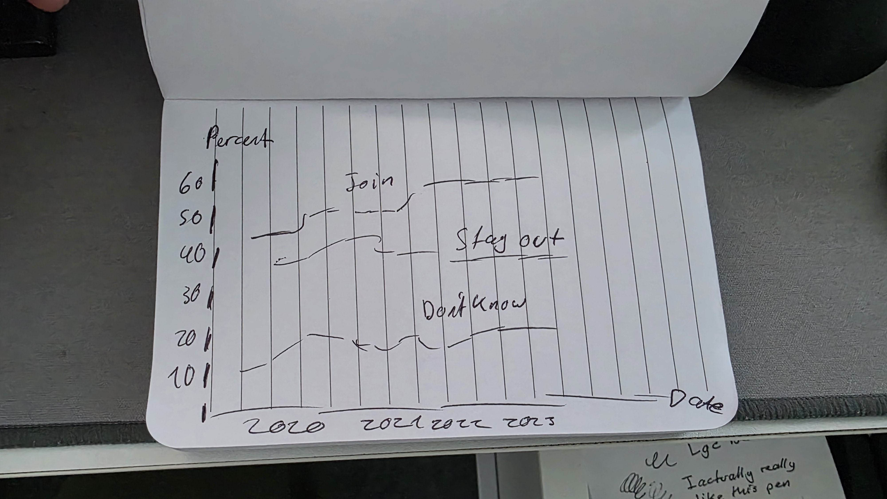

@import "../../lectures/css/datavis.less"

```elm {l=hidden}
import Tidy exposing (..)
import VegaLite exposing (..)
```

<!-- Everything above this line should probably be left untouched. -->

# Session 1: Practical Exercises

{(task|}

Task 1 complete and setup

{|task)}

## Q.2 Datavis Evaluation

1. The visualisation represents the massive differences in scale between living things, beginning with extremely small things such as DNA and gradually moving towards much larger organisms. Showing these visually makes the differences in size much easier to understand than simply listing measurements.

2. A major strength of the visualisation is that each object can be compared with those before and after it. This gives the user a clear sense of relative scale and makes otherwise difficult size differences easier to understand.

3. The user progresses through the visualisation by scrolling and moving through increasingly larger forms of life. This interaction allows the user to control the pace of the experience rather than being presented with all of the information at once.

4. The visualisation has a clear progression from the smallest elements of life towards increasingly larger organisms. This creates a narrative of scale and gives the user a sense of discovery as they move through it.

5. The hand-drawn scientific illustrations, animation, sound effects and cello music make the visualisation visually and emotionally engaging. The artistic presentation encourages the user to continue exploring while still communicating the underlying information clearly and neatly.

## Q.3 Bicycle Hires Visualization

```elm {l v}
bikehireBarchart : Spec
bikehireBarchart =
    let
        data =
            dataFromUrl "https://gicentre.github.io/data/bicycleHiresLondon.csv"

        enc =
            encoding
                << position X [ pName "Month", pTemporal ]
                << position Y [ pName "NumberOfHires", pQuant ]
    in
    toVegaLite [ width 640, data [], enc [], bar [] ]
```

The visualisation shows a clear seasonal pattern in bicycle hires, with higher numbers generally taking place during the warmer summer months and lower numbers during winter. There is also a noticeable drop around 2020, followed by a recovery afterwards. Overall, bicycle usage appears to fluctuate regularly throughout the year rather than remaining constant.

## Q.4 Creating a Scatterplot

```elm {l v}
bikehireScatterplot : Spec
bikehireScatterplot =
    let
        data =
            dataFromUrl "https://gicentre.github.io/data/bicycleHiresLondon.csv"

        enc =
            encoding
                << position X [ pName "NumberOfHires", pQuant ]
                << position Y [ pName "AvHireTime", pQuant ]
    in
    toVegaLite [ width 640, data [], enc [], circle [] ]
```

The scatterplot compares the number of bicycle hires in each month with the average duration of said hires. It allows us to see whether months with more bicycle hires also tend to have longer or shorter average hire times.

## Q.5 Data Challenge

```elm {l v}
euPolls : Spec
euPolls =
    let
        data =
            dataFromUrl "https://gicentre.github.io/data/euPolls3.json"

        enc =
            encoding
                << position X [ pName "Date", pTemporal ]
                << position Y [ pName "Percent", pQuant ]
                << color [ mName "Answer", mNominal ]
    in
    toVegaLite [ width 640, data [], enc [], circle [] ]
```

I used a scatterplot to show how the polling percentages change over time. The colours separate the different answers so it is easier to compare them.

From the graph, the results seem to change quite a lot depending on the date and poll. There are some periods where support for joining the EU seems higher than staying out, but the points are quite spread out so it is not always completely clear.

## Q.6 Design Challenge


