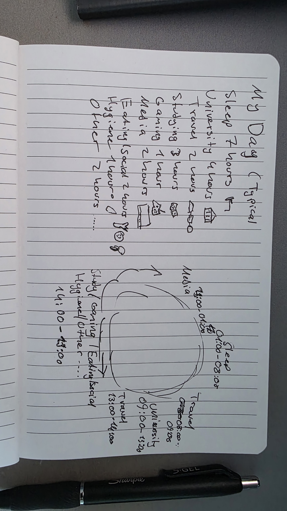

@import "../../lectures/css/datavis.less"

```elm {l=hidden}
import Tidy exposing (..)
import VegaLite exposing (..)
```

<!-- Everything above this line should probably be left untouched. -->

# Session 2: Practical Exercises

{(task|}

Use this document as a place to add your answers to the week's practical exercises.

{|task)}

## Q1. Evaluating Design Approaches

### Jonathan Corum – See, Think, Design, Produce

I think around 3 design alternatives is a good number to come out of an initial brainstorming exercise. This gives enough variety to compare different ideas without creating so many options that it becomes difficult to decide between them.

I mostly agree with Corum's statement that "the goal of the design process is to find a clear thought and then show it." A visualization should have a clear purpose and should communicate something meaningful rather than just displaying data without direction.

I also agree with his statement that "visualization is not counting." Simply showing numbers does not necessarily help the user understand the data. A better visualization should help reveal patterns, changes, comparisons or relationships that may otherwise be difficult to notice.

In terms of Bloom's taxonomies, Corum's goals go beyond simply remembering or perceiving information. His approach fits more closely with understanding, analysing and evaluating, because the user is expected to interpret the patterns shown in the visualization and use them to form conclusions.

### Sara Weber's Train Delay Scarf

I would consider Sara Weber's Train Delay Scarf a data visualization because the colours and knitted sections represent information about train delays over time.

It fits the idea of data humanism because it turns personal experience into something physical and handmade rather than using a normal computer-generated graph. The process of knitting also makes the labour involved in collecting and representing the data more visible.

It also relates to feminist data visualization because it focuses on lived experience and personal context rather than treating the data as completely neutral or detached from the person behind it.

The knitting itself makes the visualization more personal and memorable. It becomes both a visualization and an object that represents Weber's experience of commuting.

### Dear Data

I think Dear Data can still be reconciled with Corum's idea that "visualization is not counting." Although the project involves recording and counting many small events from everyday life, the main purpose is not simply to display the totals. The visualizations are used to reveal patterns and encourage reflection on personal behaviour and experiences.

Personal visualization differs from larger-scale data visualization because the person creating the visualization is directly connected to the data being represented. This can include emotions, habits and context that may be lost when working with much larger datasets.

Because of this, personal visualization can be more subjective, but it can also feel more meaningful and easier to relate to.

### Data Ink and Chart Junk

The data ink in a visualization is the part that directly represents the data, such as bars, lines, points or values.

Non-data ink includes things such as backgrounds, borders, decorative images, unnecessary labels or other visual elements that do not directly represent the data.

Some non-data ink can still be useful if it helps the viewer understand the visualization. However, if it is mainly decorative and does not improve understanding, it could be considered chart junk.

I think chart junk is sometimes included because designers want a visualization to look more interesting, attractive or memorable. However, too much decoration can distract the viewer from the actual information being shown.

### BBC Lie Factor

The BBC graphic has a lie factor because the visual difference shown appears larger than the actual difference in the data.

This means the graphic exaggerates the size of the effect and could make the viewer believe that the difference is more significant than it really is.

The main issue is that the size of the visual elements is not directly proportional to the values that they represent, which goes against Tufte's idea of graphical integrity.

### Accessible Chart Makeover

The accessible chart makeover is influenced by Tufte's minimalist principles because it removes unnecessary visual elements and focuses mainly on presenting the data clearly.

It also reduces clutter and avoids adding decoration that does not help the viewer understand the data.

However, it differs from strict minimalism because accessibility can sometimes require adding extra information rather than removing it. For example, labels, stronger contrast or additional visual guidance can help make the visualization easier to understand for a wider range of users.

Because of this, I think the design follows Tufte's principles in reducing unnecessary elements, but does not treat minimalism as more important than accessibility.

## Q2. Creating a Minimalist Tufte Visualization

I have completed Q2 and added all the files to session02 of my portfolio. Below I have put my minimal histogram evaluation:

## Evaluation

I removed the colour encoding, axis titles, tick marks and chart border to make the visualization more minimal.

I think removing the colour works well because the IMDB rating is already represented on the x-axis, so the colour was repeating information that was already shown. Removing the border and some axis details also makes the chart look less cluttered.

However, removing too much information can make the chart harder to understand. I kept the basic axis values because they are still needed to understand the ratings and frequency of films.

Overall, I think the minimalist version is easier to read, but some non-data ink is still useful when it helps the viewer understand the graph.

## Q3. Creativity Challenge



I recorded how I spent my time during one day and represented it using a hand-drawn 24-hour visualization. I included activities such as sleeping, university, travelling, studying and leisure.

Drawing the visualization by hand made the data feel more personal than a normal digital chart. It also made me think more about how I actually spend my time. The design is less precise than a computer-generated graph, but I think it communicates the overall pattern of my day quite clearly.
