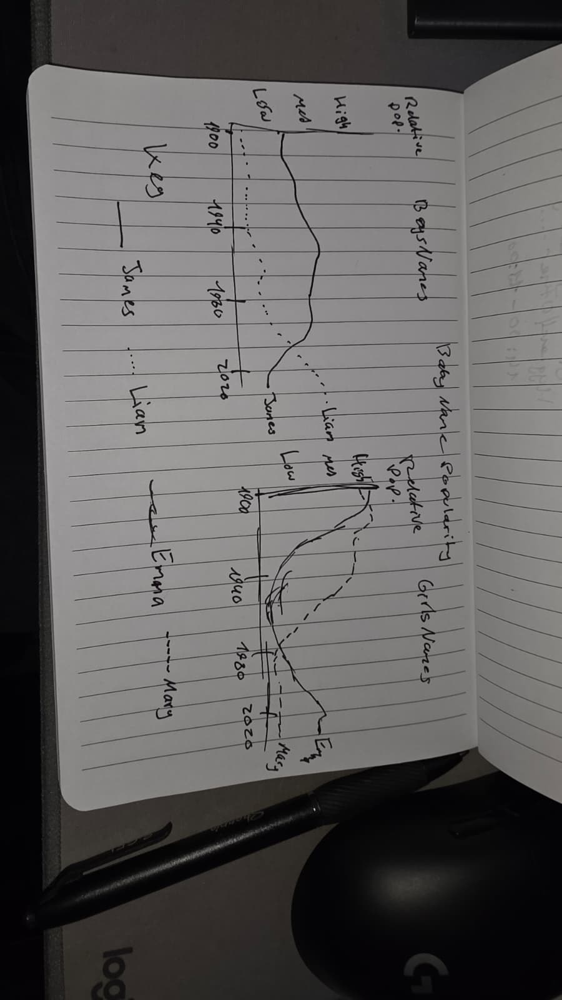

@import "../../lectures/css/datavis.less"

```elm {l=hidden}
import Tidy exposing (..)
import VegaLite exposing (..)
```

<!-- Everything above this line should probably be left untouched. -->

# Session 5: Practical Exercises

{(task|}

Use this document as a place to add your answers to the week's practical exercises.

{|task)}

## Q1. Measurement Types and Colour Schemes

| Data                                                                                           | Measurement type | Colour Scheme | Justification                                                                           |
| ---------------------------------------------------------------------------------------------- | ---------------- | ------------- | --------------------------------------------------------------------------------------- |
| 1. Student cohorts in an attendance streamgraph                                                | Nominal          | dark2         | Cohorts are separate categories without a natural order, so distinct colours work well. |
| 2. FTSE 100 indices over the last 12 months                                                    | Quantitative     | blues         | A sequential scheme can show lower and higher index values.                             |
| 3. Your assessment marks for all completed modules                                             | Quantitative     | viridis       | Marks are numerical values and a gradual colour scale shows differences.                |
| 4. Political party of elected MPs                                                              | Nominal          | category10    | Distinct colours make political parties easier to identify.                             |
| 5. Responses to a 5-point [Likert](https://en.wikipedia.org/wiki/Likert_scale) survey question | Ordinal          | blueorange    | A diverging scheme can distinguish disagreement, neutral responses and agreement.       |

I chose categorical colour schemes for data without a natural order, such as political parties and student cohorts. For numerical data like assessment marks, I chose sequential schemes because the colours can gradually change with the values. For Likert responses, a diverging scheme seems useful because it separates agreement and disagreement around a neutral response.

## Q2. Modifying the Attendance Streamgraph

```elm {l v}
attendanceModified : Spec
attendanceModified =
    let
        cfg =
            configure
                << configuration (coView [ vicoStroke Nothing ])
                << configuration (coAxis [ axcoTicks False, axcoDomain False, axcoLabelAngle 0 ])

        data =
            dataFromUrl "https://gicentre.github.io/data/attendance.csv"
                [ parse [ ( "session", foNum ) ] ]

        enc =
            encoding
                << position X [ pName "session" ]
                << position Y
                    [ pName "attendance"
                    , pQuant
                    , pStack stCenter
                    , pAxis []
                    ]
                << detail [ dName "id" ]
                << color
                    [ mName "cohort"
                    , mNominal
                    , mScale [ scScheme "dark2" [] ]
                    ]
    in
    toVegaLite
        [ width 600
        , height 300
        , cfg []
        , data
        , enc []
        , area
            [ maLine (lmMarker [])
            , maInterpolate miMonotone
            ]
        ]
```

### Evaluation

I changed the colour scheme to dark2 because it uses distinct colours that make the different student cohorts easier to tell apart.

I think this works well for the streamgraph because the cohorts are categories rather than numerical values. However, the overlapping streams can still make it a little difficult to compare exact attendance numbers.

## Q3. Global Temperature Data Challenge

### The Economist Cover

I think the Economist cover uses colour effectively because the transition from blue to red makes the overall warming trend quite noticeable.

The design is also quite simple and doesn't need much explanation to communicate that temperatures have changed over time.

However, it is difficult to tell the exact differences in temperature just from the colours, and the graphic could be confusing without knowing what the colour scale represents.

### Design 1 – Temperature Anomaly Line Chart

```elm {l}
temperatureData : Data
temperatureData =
    dataFromUrl "https://gicentre.github.io/data/temperatureAnomalies.json" []
```

```elm {l v}
temperatureLine : Spec
temperatureLine =
    let
        enc =
            encoding
                << position X
                    [ pName "Date"
                    , pTemporal
                    , pTitle "Year"
                    ]
                << position Y
                    [ pName "Anomaly"
                    , pQuant
                    , pTitle "Temperature Anomaly"
                    ]
    in
    toVegaLite
        [ width 650
        , height 300
        , temperatureData
        , enc []
        , line [ maColor "steelblue" ]
        ]
```

The line chart is useful for showing the changes in temperature anomalies over time. It makes it easier to notice the overall trend, although the monthly changes make the line look quite busy.

### Design 2 – Colour-Encoded Temperature Bars

```elm {l v}
temperatureBars : Spec
temperatureBars =
    let
        enc =
            encoding
                << position X
                    [ pName "Date"
                    , pTemporal
                    , pTitle "Year"
                    ]
                << position Y
                    [ pName "Anomaly"
                    , pQuant
                    , pTitle "Temperature Anomaly"
                    ]
                << color
                    [ mName "Anomaly"
                    , mQuant
                    , mScale
                        [ scScheme "redblue" []
                        , scDomain (doMid 0)
                        ]
                    ]
    in
    toVegaLite
        [ width 700
        , height 300
        , temperatureData
        , enc []
        , bar []
        ]
```

I used a diverging red-blue colour scheme because temperature anomalies can be above or below zero. Zero represents the reference temperature rather than an absence of temperature.

This makes it easier to separate warmer and cooler periods. I think this is an improvement in terms of colour, although there are so many monthly values that the bars are quite narrow.

### Overall Evaluation

I think the line chart is better for following the temperature changes over time, while the coloured bar chart makes positive and negative anomalies more noticeable.

The diverging colour scheme works well because it has a meaningful midpoint at zero. However, colour alone is not enough to compare precise values, which is why keeping the vertical axis is useful.

Seasonal patterns could also be explored by grouping the monthly data by month of the year, rather than displaying every month in one long timeline.

### Q4. Black-and-White Baby Name Visualisation



### Explanation

I designed two separate line charts for boys' and girls' names, showing how their popularity changes over time.

Instead of using different colours, I used solid, dashed and dotted lines to distinguish the names. I also labelled the lines to make them easier to follow.

I think this design works well when comparing a few names, although it could become confusing if too many names were displayed at once.
